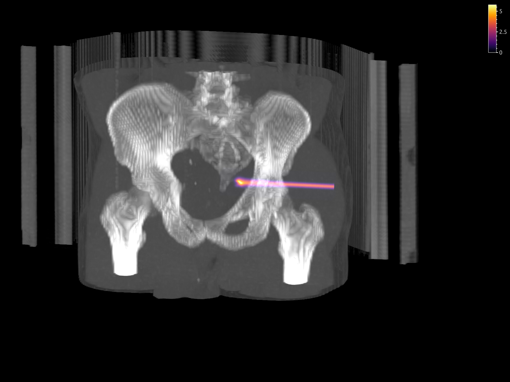

# proton-dose-m1

**A third-order deterministic solver for proton therapy dose calculation,
based on the $M_1$ angular moment model.**

Developed for the MSc thesis *Moment Methods for Proton Therapy Dose
Calculations* (A. El Hachmioui, Delft University of Technology, 2026;
supervisors D. Lathouwers, M. B. van Gijzen, E. Benschop).


*Integrated depth dose of a 150 MeV proton beam in water on a 0.5 mm grid.
First-order and MUSCL reconstruction smear out the Bragg peak; the
third-order WENO-Z scheme lies on top of the Monte Carlo reference.*

## The problem

Proton transport is described by the Boltzmann-Fokker-Planck (BFP)
equation. Because protons move in almost one direction, resolving its
angular dependence directly is expensive. The $M_1$ moment model removes the
angle: it evolves only the scalar and vector fluence, closed with the
entropy-based $M_1$ closure, so that only space and energy remain.

The difficulty is numerical diffusion. The protons of one energy form a thin
layer that is transported over the full range of the beam, so a low-order
scheme spreads them out like an artificial range straggling. With
first-order or second-order (MUSCL) reconstruction, the Bragg peak drops by
up to 52% and 30% and the distal falloff broadens by several millimetres,
even on a 0.5 mm grid.

## The method

Within the literature reviewed in the thesis, the $M_1$ model of proton
transport had not been solved with a high-order finite-volume method. This
code does so. A high order is only reached if every part of the scheme has
it, so each component is chosen for that:

- **WENO-Z reconstruction** (fifth order on smooth data), with first-order
  and MUSCL reconstruction for comparison
- **HLL fluxes** with the exact $M_1$ characteristic speeds
- a **realizability projection** that keeps the moments physically admissible
- **IF-SSPRK3**, a third-order strong-stability-preserving Runge-Kutta march
  in energy with a step-local integrating factor that absorbs the stiff
  scattering and nuclear-removal terms
- a consistent high-order **inflow boundary**

The physics model contains continuous energy loss (CSDA), Wentzel-VI
small-angle scattering, and primary-proton nuclear removal, with material
data from Geant4.

## Results

The solver is verified against a particle Monte Carlo solver of the same BFP
equation with the same material data, so all differences come from the
$M_1$ closure and the discretization. Ranges are over six benchmarks: water,
a bone slab across the beam, and a lateral water-bone interface, each with
and without scattering and nuclear removal.

| | First order | MUSCL | WENO-Z |
|---|---|---|---|
| Observed convergence order (dose) | 0.96 | 1.80 – 1.84 | **3.11 – 3.21** |
| Maximum-dose difference | −20% to −52% | −18% to −30% | **−0.8% to −5.9%** |
| Distal falloff broadening | 9.7 – 10.7 mm | 2.5 – 3.1 mm | **≤ 0.18 mm** |
| Gamma pass rate, 1%/1 mm | 84.3 – 92.5% | 94.1 – 98.3% | **99.46 – 100%** |

In a geometry derived from a prostate CT, 99.99% of the voxels pass the
1%/1 mm criterion and the maximum dose differs by 1.7%.

**Speed.** The main goal of the thesis was accuracy; speed came second, and
the work on it is not finished. The first results are promising. The plain
solver is not yet optimized, and at equal statistical accuracy the
same-model Monte Carlo solver is still faster. A *moving active domain*,
which only transports a box that follows the beam through the energy march,
already makes WENO-Z up to 11 times faster. With it, the deterministic
solver is 1.7 times faster than Monte Carlo in water and 2.9 times faster
with a bone slab, at a dose change below 0.06% of the maximum. At a lateral
water-bone interface the moving domain still changes the dose by 1.6%, so
making it exact there is the next step (thesis Appendix D.4). Together with
the accuracy results, this suggests that a high-order moment method can
compete with Monte Carlo in both accuracy and speed.

**Limitations.** At a lateral water-bone interface, a local dose deficit of
about 10% within 0.5 mm of the interface persists under refinement,
consistent with a limitation of the $M_1$ closure. The BFP model neglects
energy-loss straggling and secondary particles; a comparison with
full-physics Monte Carlo codes and measurements is future work.

## Installation

Requires Python 3.11 and [uv](https://docs.astral.sh/uv/).

```
uv sync
```

The solver runs on the CPU with Numba. An experimental GPU path uses CuPy
(`uv sync --extra gpu`); it was not used for the thesis results.

## Repository layout

```
src/proton_solver/        solver package
  numerics/               grid, reconstruction, HLL flux, energy march, realizability
  physics/                stopping power, scattering, nuclear removal, materials
  bfp_mc/                 BFP Monte Carlo reference solver
  analytical.py           analytical CSDA free-streaming solution
  convergence.py          self-convergence studies
  metrics.py              gamma analysis, maximum dose, R80, distal falloff width
  topas/                  TOPAS input writer (not used for the thesis results)
examples/                 small, quick examples of the solver API (see below)
thesis_experiments/       one script per result of the thesis (see below)
tools/                    checks, figures, and the export of tables for the thesis
  geant4_material_data/   generation of the material tables in data/ from Geant4
docs/                     figure used in this README
data/                     material tables (stopping power, Wentzel-VI transport
                          coefficient, nuclear removal) for five Geant4 materials
```

## Examples

Small configurations that run in one to a few minutes and show the solver
API. Each writes its results and plots to `results/<run>/`.

| Example | What it shows |
|---|---|
| `examples/homogeneous.py` | Reduced model in water against the analytical CSDA solution |
| `examples/longitudinal_slabs.py` | Extended model, bone slab across the beam, against the BFP Monte Carlo |
| `examples/transversal_slabs.py` | Extended model, lateral water-bone interface, against the BFP Monte Carlo |
| `examples/convergence_study.py` | Self-convergence study (coupled, space-only, or energy-only refinement) |
| `examples/topas_case.py` | Export of a configuration to TOPAS (requires a TOPAS installation) |

Run them with, for example, `uv run python examples/homogeneous.py`.

## Reproducing the thesis results

All commands are run from the repository root. Results are written to
`thesis_results/` (see *Included results* below). Monte Carlo references are
cached in `bfp_mc_cache/`, so repeated runs reuse them.

| Thesis | Command |
|---|---|
| §5.2 Reference verification | `uv run python -m thesis_experiments.reference_verification.bfp_mc_vs_analytical` |
| §5.2 Interpolation check | `uv run tools/check_analytical_interpolation.py` |
| §5.2.3 Reference uncertainty | `uv run tools/reference_uncertainty.py` |
| §5.2.3 Extended-model reference checks | `uv run tools/check_reference.py` |
| §5.3 Convergence, WENO-Z | `uv run python -m thesis_experiments.numerical_verification.reduced_physics_convergence` and `...scattering_nuclear_convergence` |
| §5.3 Convergence, first order and MUSCL | `uv run python -m thesis_experiments.robustness.convergence_schemes` |
| §5.3 Convergence, PCHIP coefficients | `uv run python -m thesis_experiments.robustness.convergence_pchip_coefficients` |
| §5.3 Convergence, 36 mm domain | `uv run python -m thesis_experiments.robustness.convergence_long_domain` |
| §5.3.4, App. D.1 Energy-only convergence | `uv run python -m thesis_experiments.numerical_verification.energy_convergence` |
| §5.3.4, App. D.1 Space-only convergence | `uv run python -m thesis_experiments.numerical_verification.spatial_convergence` |
| App. D.1 Space-only error along the axis | `uv run tools/spatial_convergence_profile.py` |
| §5.4 Reduced-model benchmarks | `uv run python -m thesis_experiments.reduced_physics.<case>` |
| §5.5 Extended-model benchmarks | `uv run python -m thesis_experiments.scattering_nuclear.<case>` |
| §5.5.1 Lateral width | `uv run tools/lateral_width.py` |
| §5.5.3 Lateral-interface profiles | `uv run tools/interface_profile.py` |
| §5.5.4 CT-derived geometry | `uv run python -m thesis_experiments.scattering_nuclear.ct` |
| App. D.2 Coarser grids | `uv run python -m thesis_experiments.robustness.coarse_grid` |
| App. D.3 Lateral refinement | `uv run python -m thesis_experiments.robustness.interface_lateral_refinement` |
| App. D.4 Moving active domain | `uv run python -m thesis_experiments.robustness.moving_active_domain` |
| Figure 5.2 Geometry previews | `uv run tools/generate_geometry_previews.py` |
| All tables, copy for the thesis | `uv run tools/export_thesis_results_latex.py` |

`<case>` is `homogeneous_water`, `longitudinal_slabs`, or `transversal_slabs`.
Each benchmark script runs first-order, MUSCL, and WENO-Z reconstruction and
the BFP Monte Carlo reference with $10^8$ histories; the reference takes the
largest part of the runtime.

`tools/export_thesis_results_latex.py` generates the LaTeX tables and copies
the figures used in the thesis from `thesis_results/` to
`thesis_results_latex/`, which is uploaded to the `figures/` folder of the
thesis.

### Included results

`thesis_results/` contains the results of all runs above: for every run the
configuration (`config.json`), the code version and runtime
(`metadata.json`), the metrics (`metrics.json`), and the figures and tables.
`thesis_results_latex/` contains the tables and figures exactly as used in
the thesis. The full three-dimensional dose and fluence arrays (`*.npz`,
about 3.5 GB) are not included; rerunning a script regenerates them. The
results were produced with development versions of this code; the solver
and the evaluation of the results are unchanged in this repository.

## CT data



The CT-derived case uses the prostate CT of the CORT dataset (Craft et al.,
*GigaScience* 3:37, 2014, doi:10.1186/2047-217X-3-37), which is included as
`data/ct/prostate.npz` (CC0; see `data/ct/README.md`), a Hounsfield-unit
array of shape (183, 183, 90) with 3 mm voxels. After running
`thesis_experiments.scattering_nuclear.ct`, the dose can be inspected on the
CT with napari:

```
uv run --with "napari[all]" python -m thesis_experiments.scattering_nuclear.view_ct
```

## Material data

The tables in `data/` were generated with Geant4
(`G4EmStandardPhysics_option4`; for water this includes the ICRU90 stopping
power) by the programs in `tools/geant4_material_data/`. Both the
deterministic solver and the BFP Monte Carlo solver read the same tables.

## Citation

If you use this code, please cite the thesis:

> A. El Hachmioui, *Moment Methods for Proton Therapy Dose Calculations*,
> MSc thesis, Delft University of Technology, 2026.

GitHub's *Cite this repository* button gives the same reference in BibTeX
and APA format (from `CITATION.cff`).